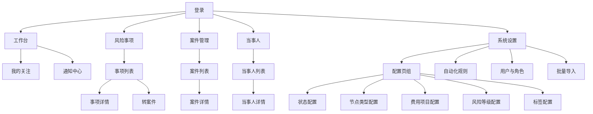
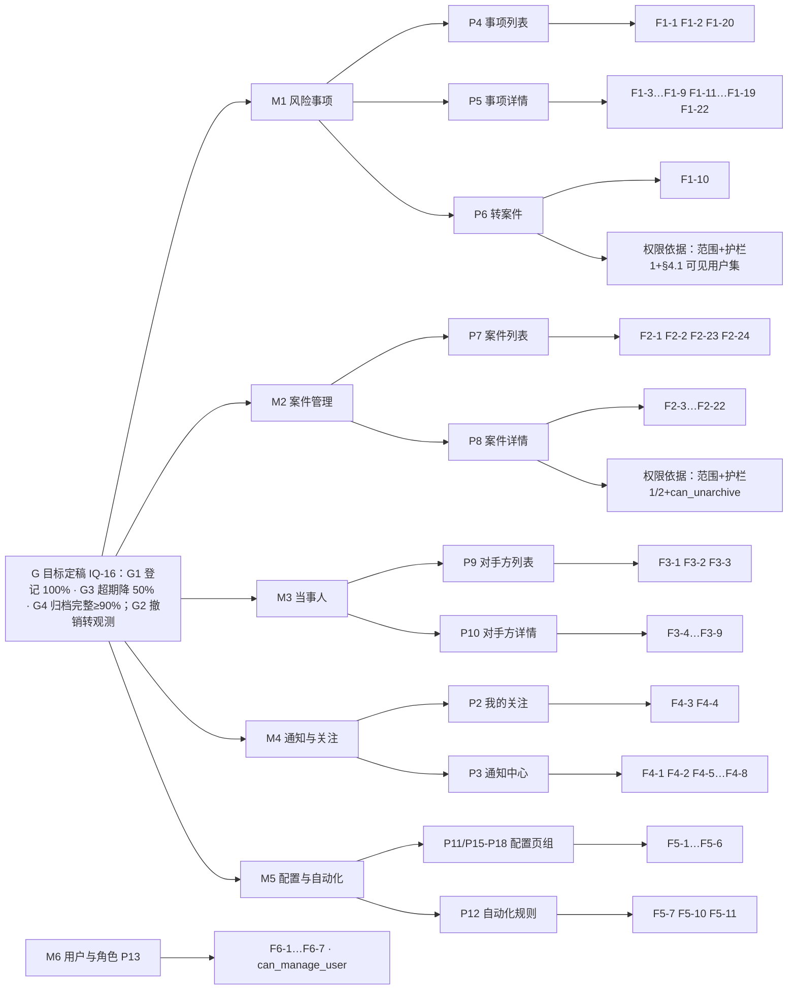

# MatterNest 第一期 PRD 主文档（总纲 + 功能清单 + 设计图集）

> 状态：**v7（草案口径，IQ-1…14 已并入，2026-10-10）**。本文件是 PRD 主线索引，不重复规格件的字段/规则细节；凡与其他文件重叠，权威链见 §0.2。**功能设计的意图对齐结论看 §7.4 与 `docs/PRD-phase1-alignment-*.md` 七件**——本文件正文是它们的投影。
> 生成方式：prd-generator 技能，基线 = `PRD-phase1-baseline-v0.md`（用户 2026-09-26 粘贴），投影数据源 = §4.2 功能清单的 M/F 编号。
> 本轮未编造需求：§2/§3 中凡基线与规格件都没有的，一律标 `【待产品确认】`；§4.2 每条 F 都带出处。

---

## 0. 文档地图

### 0.1 一期文档清单

| 文件 | 角色 | 状态 |
|---|---|---|
| `PRD-phase1-baseline-v0.md` | 需求源（原文口径）+ 「原文 X.Y ↔ 基线节号」对照表 | 仓库新收录，内容不改写 |
| `PRD-phase1-master.md` | 本文件：目标 / 故事 / 功能清单 / 四张图集 / 交付设计 / 冲突登记 | **v7**（IQ-1…14 意图对齐已并入正文投影） |
| `PRD-phase1-design-revision-r1.md` | 一致性修订 A1–A9 + C，PG 落地 | **R2**（2026-10-10 意图对齐回写：显示名/receivers/规则 host_type/清单#3 作废/id 序列化/三重防线/B7-B8 结案；§10 未闭合项已刷新） |
| `PRD-phase1-permission-design-draft.md` | 权限与数据范围 | **v5**（2026-10-10 意图对齐回写：企业措辞、`can_read_plain` 收窄、P0-6 结案、§4.1 创建期例外、空置事项注） |
| `PRD-phase1-enums-and-schemas.md` | **取值权威源** | **v4**（2026-10-10 意图对齐回写：E13 非诉❌、E06/E12 我方视角、E07 `represented` 软作废（IQ-15）、E16 待改名、E25 仅 in_app、显示名、§3 补 `EXPORT`/`PARTY_MERGED`/`BULK_IMPORT` 与作废标注；结构未动） |
| `PRD-phase1-risk-to-case-mapping.md` | 转案件字段映射 | **v3**（2026-10-10 意图对齐回写：入口性质注、当事人范围注、撤销一致性句、`represented` 清理 IQ-15；映射对应关系未动） |
| `tech-stack-decision.md` | 技术选型 | **v6**：全栈 **Next.js 16**（React + **Ant Design 6** + Tailwind v4 只管容器布局），后端仍 TS 同仓；认证双通道（我方适配云之家）。§11/§12 的 Nuxt 结论已被 §13 取代，**v5 的纯 shadcn 前端结论已被 §13.6 取代** |
| `implementation-plan-v1.md` | **落地方案**：门禁 / 里程碑 M0–M7 / 工作分解 WBS / 规范条款 / 验收门禁 / AI 派单边界 | v1，与本文同源 |
| `research-nuxt-fullstack-nitro.md` | 一手核验：Nitro/session/上传/Drizzle DDL | v3 依据；框架结论部分已过期，C1/C3/C4 已搬进技术选型 §13.2 |
| `research-nuxt-table-vue-ui.md` | 一手核验：表格能力与 shadcn-vue 端口 | v4 依据；作对照保留，现行结论看 **§13.6** |
| `research-nextjs-stack.md` | 一手核验：Next 16 proxy 运行时 / 鉴权落点 / 调度 / 多副本 / 自托管 | **v5 依据**，含 N1–N7 spike 通过标准；⚑ 其中"组件体系=shadcn"那部分已被技术选型 §13.6 改判为 antd 6，Next/后端侧结论不变 |
| `PRD-phase1-alignment-m1…m7-m8.md`（七件） | **意图对齐产出**：每模块 US + 预期描述 + 功能描述 + 偏差登记（2026-10-10） | ✅ 现行。功能设计口径以此七件+§7.4 为准，本文件正文为其投影 |
| `PRD-phase1-alignment-final.md` | 对齐终审摘要（波次表、偏差归堆、遗留门） | ✅ 现行 |
| `GLOSSARY.md`（仓库根） | **业务术语权威**（企业当事方口径，含权限角色节） | ✅ 现行，随对齐更新 |
| `docs/adr/0001-enterprise-party-not-law-firm.md` | 企业当事方改判的决策记录 | ✅ accepted |

### 0.2 冲突裁决链

**第 0 层（2026-10-10 起新增）**：凡涉及产品定位、词汇口径（企业当事方 vs 旧律所措辞）、术语定义 → `docs/adr/0001` + `GLOSSARY.md` + 本文 §7.4（IQ-1…14）说了算。
`枚举取值` → 枚举表说了算；`权限判定` → 权限草案说了算；`转案件语义` → 映射矩阵说了算；`状态/规则/字段/存储` → 修订稿说了算；`以上都没覆盖的` → 基线 v0；仍然冲突 → 进本文件 §7 排队，不许就地取舍。**功能设计两文件打架时，以 `PRD-phase1-alignment-*` 七件为准并回改本文件**（IQ-4：PRD 是草稿）。

---

## 1. 版本说明

| 版本 | 日期 | 变更（跟着 Review 走） | 来源 |
|---|---|---|---|
| v0 | 一期启动 | 基线全文：6 模块 + 14 条交付确认清单 | 用户粘贴，本次入仓 |
| R1 | — | A1–A9 + C 一致性修订，18 项已定基调 | 修订稿 §0/§0.1 |
| B1-v3 | — | 权限模型定稿：三档范围 + 4 特权 + 2 护栏，案例与 MCP 移出 | 草案 §11/§12 |
| B6 | — | 枚举与结构登记表 | 枚举表 |
| D | — | 转案件映射矩阵 | 映射矩阵 |
| T1–T3 | — | 全栈 Nuxt 4 + Drizzle + PG15+ + MinIO | 技术选型 §12 |
| master-v1 | 2026-09-26 | 本次审查：收录基线、补目标/故事/图集/交付设计；登记 P0 冲突 6 条、P1 缺口 12 条 | 本文件 |
| **master-v2** | 2026-09-26（同日） | 你裁定 9 条（Q1–Q5 + P0-2/3/4/5 + 基线版本确认）→ 六份文件同步回改：枚举权威回改 5 处、失效指针 7 处、新增 E29–E33、补 `UNCONVERT`、预置规则 7→8 条、草案新增 §4.1 与 P-4/P-5、报表收窄、§9 误引纠正。唯一未决 = P0-6 | 本文件 §7.3 |
| master-v3 | 2026-09-26（同日） | 认证决策落定：**云之家 + 本地密码双通道**（密码只给兜底账号；首登自动建号落 `pending`）。新增 F6-8…F6-11 与 3 张认证外挂表、枚举 E34–E37 与 `USER_ACTIVATED`；§7 假设 C 作废并新增 E/F；技术选型 §2/§5/"216 例"/§10 条目四处矛盾修平。 | 技术选型 §3.4 |
| master-v4 | 2026-09-26（同日） | 认证口径最终定为**我方适配云之家**（非改造平台），连带离职回收降级为待签字风险（P1-16）；前端定稿纯 shadcn **（当时落点为 Vue 端口）**，P1-17 结案（**PC 浏览器为主**）；补做 `research-nuxt-table-vue-ui.md` 一手核验并登记未证实项 | 技术选型 §3.3/§7/§12、研究文档 |
| **master-v5** | 2026-09-26（同日） | 技术选型升 **v5**：前端换 **Next.js 16 + React + 纯 shadcn**，后端仍 TS 同仓（明确**不进 Python**——shadcn 一等来自 React，与后端语言无关；换 Python 会破枚举表 §5.1 单一事实源）。新增 `implementation-plan-v1.md` 落地方案与 `research-nextjs-stack.md` 一手核验（Next 16 proxy 默认 Node 运行时、鉴权须落在每个 handler、多副本两个必需变量） | 技术选型 §13 |
| **master-v6** | 2026-09-28 | 技术选型升 **v6**：**前端组件体系由纯 shadcn 改判为 Ant Design 6**（用户两次否同一套观感并定方向；`@ant-design/pro-components` 的 peer 不含 antd 6 ⇒ ProTable/ProForm 出局，查询区与表格壳自己写）。禁令⑦⑧ 改写为"体系唯一 + 色值单源 + 服务端分页门不变"，日期库换 `dayjs`，表单校验仍从 `shared/schema` 的 Zod 推导。**需求、权限模型、枚举、里程碑与门禁一条没变**；11 项依赖出仓、14 个 shadcn 原语删除、Demo 轮约 1.5 天视觉工作作废（代价记在 §13.6.4） | 技术选型 §13.6 |
| **master-v7** | 2026-10-10 | **意图对齐回写（IQ-1…14）**：根定位改判**企业当事方**（非律所代理人，十人规模，ADR 0001）；当事人=对方/第三人（我方为案件单值属性）；案件=正式法律程序（删"非诉"）；转案件非唯一入口；M1 无预设节点/owner 可空/评论主界面；M2 保留节点模板/文书生效即结案；M3 对手方档案+新增 F3-9 合并；M4 上报人回音走规则 receivers 加 creator、email 撤一期；M5 砍自建规则、配置页独立、智能体配置出局；M6 展示层全明文（`can_read_plain` 语义收窄为仅明文导出，开关数不变）；M7 批量导入一期做；P0-6/P1-4/6/8/9/11/12/13/16(语义)/19/20/21 结案。§4.2 各行、§7.1/7.2 状态列已按终态改写；**模块细节看 `docs/PRD-phase1-alignment-*.md` 七件**，裁定索引看 §7.4 | 本节 §7.4、`docs/PRD-phase1-alignment-final.md` |

---

## 2. 背景与目标

**背景（基线 1.1 + 2026-10-10 改判 IQ-1/Q50）**：一家**企业**的法务团队（约 **10 人**）管理本企业卷入的诉讼与涉诉前风险。基线时代的"律所内部"口径作废（ADR 0001：企业是案件的当事方，不是替别人打官司的代理人）。风险事项与案件目前分散在台账与个人记录里，"风险 → 案件"的转化链路没有系统承载：转案件时字段靠手抄、期限靠记忆、关注人靠口头，结案后材料封存无人回收。MatterNest 以台账式管理为起点，把这条链做成一条有状态、有节点、有审计的生命周期。

**核心价值（IQ-2）**：**风险事项的记录与管理 + 案件的记录与管理 + 两者的转换**，三件套并列；M3/M4/M5/M7/M8 皆为其服务或附属（逐模块对齐时按"是否服务三件套"做减法）。

**目标（✅ 定稿，IQ-16 签字批准，2026-10-10；代拟过程见 `docs/PRD-phase1-g-targets-b5-draft.md`）**：基线全文没有可衡量目标。定稿四条 + 一条降级：

| # | 目标（定稿句） | 度量与达标线 |
|---|---|---|
| G1 | 上线 3 个月内，新发生的风险事项与诉讼案件 **100% 在系统登记**（不再回旧台账） | 台账抽对 + 登记计数；100% |
| ~~G2~~ | **KPI 撤销（用户裁"转案件不是强制的"）**。旧"完整率≥90% + 反绕过"口径作废——它与 IQ-3"被诉直建案是正当路径"自相矛盾 | 降级为 §6.1 **观测指标**：转案件链路使用率，无达标线。读法：若长期≈0，说明三件套的"转换"价值假设（IQ-2）未兑现——那是**复盘信号，不是考核**。链路正确性（转出案件必能在事项详情反查）属 F1-19/F2-22 功能验收，不占目标位 |
| G3 | 期限类节点提醒到达率 100%（一期仅 `in_app`：事件生成即到达）；开庭/举证类节点**超期未处理数 3 个月内环比降 50%** | `dedupe_key` 计数；节点超期行数趋势 |
| G4 | 归档案件的**材料完整率 ≥90%**（口径：归档动作时 `F2-26 归档完备性检查` 三项全过——①裁判文书类附件≥1 ②`closing_date` 已填 ③无待定未决节点；缺项强制归档记 reason 留痕，计入分母不计入分子） | 归档时点自动校验，数据源=`ARCHIVED.payload.missing_at_archive[]`（F2-26 新增） |

规模假设（待 SG-3 实数修正）：案件 30–80 件/年、事项 100–300 条/年、用户约 10 人。非功能底线五条（数据量/并发/留存/备份/部署）见 `docs/PRD-phase1-g-targets-b5-draft.md` 第一部分末表，其中部署形态行与 MATT-35 决策票联动。

---

## 3. 故事介绍

### 3.1 场景描述（一行一件事，来自基线功能地图 + 规格件）

```text
同事从云之家工作台点进应用，授权回调即完成登录，不必再记一个密码
运维留了一个本地密码账号兜底，云之家不可达时才用它进来
企业内有人离职，在职同步把他置为停用并当场吊销会话，他手里的案卷链接立刻 404
采购发现供应商有违约苗头，自助登记一条风险事项（FX-20260926-001），选风险等级"高"，顺手填了处理人与关注人
法务在产品里看到这条，把处理人改成自己——就是一次普通编辑，没有受理流程
经办人在事项下评论"已核查，先发函催告"；上报人在通知中心收到回音（关注列表里没有那条被动记录）
核查后对方起诉、法院立案，详情页点「转案件」，一次生成 2 个案件（AJ-…-001/-002）
被诉的案件不必先有条风险事项——直接新建，转案件只是入口之一
案件字段逐项补录：案由、程序（诉讼/仲裁/执行）、我方诉讼地位、标的额、受理机关、对方当事人
案件进入"进行中"，规则 3 生成举证/开庭/判决节点模板，提醒默认 {7,3,1} 天
开庭时间确认后填 end_time，判决节点时间未定就留"待定"
每周录进展，附件传传票与判决书，评论里 @ 协办讨论管辖异议
费用只记支出（诉讼费/律师费/保全费），详情页看得到按项目分组合计
开庭前 3 天系统给经办人和关注人发提醒，同一天多条提醒合并为一条
判决/调解书生效，经办人置"已结案"、补 closing_date；执行回款在原案补记，不自动归档
管理员启用规则 1 后，结案才自动归档
归档后列表默认隐藏，材料只读但评论与附件仍可追加，仅 full_admin 可撤销归档
经办人在"我的关注"看未读更新，点进去直接落到对应案件
被 @ 的人在通知中心看到评论摘要，点进去按当前权限渲染正文
同一供应商在两个案件里出现，当事人（对手方档案）页能看到"我可见的"关联案件
重复建档的"华为技术/华为技术有限公司"由经办发起合并，关联改挂主记录（F3-9）
助理只想看自己承办的，角色给 self_operator（L3）
IT 只管配置和账号，看不到别人的案卷（sys_admin 刻意压到 L3）
风控要撤销一次误归档，只能找持有 full_admin 的人
证件号在页面直接可见（能看案卷即能看传票），但批量导出默认脱敏、明文导出需特权并记审计
```

### 3.2 价值分析

| 功能 | 解决什么 | 支撑哪个目标 |
|---|---|---|
| 转案件（1:N + 可追加） | 现在手抄字段，关联一断就查不到源头 | 三件套之"转换"（G1 覆盖其登记面；使用率降为观测，G2 撤销后不再挂 KPI） |
| 业务自助登记 + 可选填处理人/关注人 | 风险源头在业务一线；报了没回音，下次就不进系统 | G1（IQ-5/IQ-13） |
| 状态配置驱动 + `semantics` 锚点 | 企业内习惯叫法不同，硬编码状态永远要改代码 | G1 |
| 5 触发 × 5 动作规则 + 同域唯一 | 提醒靠人记；规则放开成通用引擎会失控（一期只运维预置 9 条，IQ-9/16） | G3 |
| `last_progress_at` 与系统写入解耦 | "30 天无更新"被自动化自己刷掉，提醒永不触发 | G3 |
| `*_staff` 作权限主表 | 20 人规模没有部门，只能靠"我与这条记录的关系"分级 | G1（敢用才会填） |
| 当事人跨案共享 + 加密脱敏 | 同一对手在多个案卷里，重复录入且证件号裸存；对手画像（"这家第三次违约"）是风险识别输入（IQ-7） | G4 |
| 通知按 `dedupe_key` 聚合 | 一次转案件推 5 条，用户两周后就开始屏蔽通知 | G3 |

### 3.3 用户核心路径

```text
风险事项路径：登记（可选填处理人/关注人）→ 评论处置〔无预设节点，有硬期限才手动加节点〕→ 转案件(1:N) → 事项归档
案件路径：    转案件/**或被诉直接新建** → 进行中(P2 生成节点模板) → 节点推进+进展+费用 → 已结案(文书生效即置，执行作补记尾巴) → 已归档(终态)
横穿：        关注人=授权 → 通知/关注 feed → 明文导出(需特权，展示层全明文 IQ-12) → 撤销归档(仅 full_admin)
```

〔2026-10-10 IQ-3/IQ-5/IQ-6 注：转案件是建案入口**之一**非唯一——企业被诉常无对应事项，强制补录会让人绕开系统私下处理（G1 的反面）。〕

### 3.4 漏斗目标【待产品确认】

### 3.4 漏斗目标（✅ 定稿，IQ-16 SG-2 批准，2026-10-10）

| 步骤 | 转化率线 | 理由 |
|---|---|---|
| 事项登记 → 产生至少一条评论/进展 | **≥60%，且为观察指标不设门槛** | 企业事项大量是"记录+观察"（Q14/Q17），挂几个月没动是常态；线定太高逼人制造假动作、怕露馅干脆不报（G1 的死法） |
| ~~事项 → 转案件 ≥90% 走系统而非直建~~ | **删除** | "绕过"分母不成立（IQ-3：被诉直建案是正当路径），随 G2 撤销同因 |
| 转案件表单进入 → 提交成功 | ≥70% | 一表单交 N 个案件、必填 6 项，放弃率天然偏高；<70% 触发表单减负复盘 |
| 提醒发出 → 期限内处置节点 | ≥60%（仅案件侧） | 事项侧无预设节点后样本基本全在案件；一期只测趋势 |
| 结案 → 30 天内归档 | ≥80% | 规则 1 默认禁用靠人工；80% 已属乐观 |

### 3.5 路径规划（让架构提前兼容，不代表承诺做）

第二期候选：案例库（`case_study.matter_id` 唯一，禁回补 `case_id` 列）、MCP 授权页、全局搜索（第一个真需要中文分词的地方）、按团队/分所隔离（=权限模型重写）、通知渠道扩展（企微/钉钉 + email + 云之家消息，E25 留位，形态看 MATT-34 摸底）、`or`/聚合的规则引擎（区分内置规则与用户可配规则两张表）、**自建规则入口（F5-8/9，IQ-9 一期出局后与引擎同批恢复）**、费用审批流（E20 预留 `approved` 语义位）、智能体配置（**一期出局定案 IQ-12/Q44**，二期再裁）、列显隐持久化（P1-21 结案范围外）、对手方涉案画像卡（等 F3-9 合并把数据洗干净，IQ-11）。

---

## 4. 概要设计

### 4.1 模块图

| 模块 | 名称 | 第一期 | 出处 |
|---|---|---|---|
| M1 | 风险事项〔IQ-5：业务自助登记、owner 可空、无预设节点、核查走评论〕 | ✅ | 基线三 + 修订稿 §3 + `alignment-m1` |
| M2 | 案件管理〔IQ-6：案件=正式法律程序（诉讼+仲裁+执行，删"非诉"）；litigation_role=我方诉讼地位；文书生效即结案；保留节点模板〕 | ✅ | 基线四 + 修订稿 §6 + `alignment-m2` |
| M3 | 当事人信息管理〔IQ-7：重定义为对手方档案，我方不入表；新增 F3-9 合并〕 | ✅ | 基线八 + 草案 §7.2 + `alignment-m3` |
| M4 | 通知与关注〔IQ-8/13：上报人回音=规则 receivers 加 creator，不入关注列表；email 撤出一期〕 | ✅ | 修订稿 §7.2 + 草案 §7.1 + `alignment-m4` |
| M5 | 配置与自动化规则〔IQ-9：一期只运维预置规则（8→9 条，IQ-16 加规则 9），自建规则出局；配置页各自独立；P1-6 已结案〕 | ✅ | 基线七/十三 + 修订稿 §2/§4 + `alignment-m5` |
| M6 | 账号与权限〔IQ-10/12：展示层全明文（`can_read_plain` 收窄为仅明文导出，四开关不删列）、创建期选人例外 IQ-14〕 | ✅ | 草案 §1–§6 + `alignment-m6` |
| M7 | 通用能力（导入/编号/审计管线）〔IQ-11：批量导入一期做，P1-4 结案〕 | ✅（导入升必做） | 基线十一 + 修订稿 §12.3 + `alignment-m7-m8` |
| M8 | 报表 | ✅ **收窄为 2 张**：案件/事项总览 + 案程节点到期，形态是列表页顶部统计卡，**不建报表页、不进菜单**（2026-09-26 裁定 P0-2） | 基线六 → 现口径见 §4.2 M8 |
| — | 案例管理 | ❌ 移出 | 修订稿 §0.1 / §9 #10 |
| — | MCP 服务与授权页 | ❌ 移出 | 修订稿 §9 #13 |
| — | 智能体配置（基线 7.4） | ❌ **一期出局**（IQ-12 Q44：与自建规则引擎同一条收窄逻辑；§3.5 二期候选保留） | 基线 7.4 → §7.4 作废登记 |
| — | 自定义字段/自定义报表/自定义列 | ❌ 不做 | 基线清单 #14 |

### 4.2 功能清单（穷举，M/F 编号 = 全部图集的数据源）

标记：`✅` 规格件已闭合；`❓` 有承诺但无规格；`⚠` 与其他文件冲突（编号见 §7）。

**M1 风险事项**

| F | 功能 | 状态·出处 |
|---|---|---|
| F1-1 | 新建事项（**owner 可空**、表单可选填处理人/关注人、**无预设节点**、`FX-` 取号） | ✅ IQ-5/13/14 + `alignment-m1` US-1 |
| F1-2 | 列表：筛选·搜索·排序·分页·「包含已归档」·**「经办人=空」仅 L1 可见** | ✅ 修订稿 §5 + IQ-10 |
| F1-3 | 事项详情查看（第二徽标"已转案件"） | ✅ 修订稿 §3.2 |
| F1-4 | 编辑事项业务字段 | ✅ **P0-6 结案（IQ-5）**：协办可改主表业务字段，关注只读；上报人可改自建事项 |
| F1-5 | 删除事项（软删） | ✅ **P1-8 结案（IQ-5）**：仅软删、无回收站 UI，库内恢复归 full_admin |
| F1-6 | 状态变更（软推荐 + 偏离必填原因） | ✅ 修订稿 §3.3 |
| F1-7 | 归档 / 撤销归档 | ✅ 修订稿 §3.3 终态 + `can_unarchive`；基线 4.2"自动撤销归档"那句作废（P0-3 裁定） |
| F1-8 | 事项节点增删改（**手动，无预设；仅时间点**） | ✅ **P1-13 结案（IQ-5/Q22）**：时间段仅案件节点 |
| F1-9 | 节点完成 / 取消 / 恢复 | ✅ 修订稿 §3.5 |
| F1-10 | 转案件（1:N，可追加，单事务 + outbox；**建案入口之一，非唯一**） | ✅ 映射 §4 + IQ-3 |
| F1-11 | 撤销转案件关联 | ✅ 映射 §5.1 |
| F1-12 | 协办 / 关注人增删（= 授权；**事项补协办**） | ✅ **P1-12 结案（IQ-5）**：与案件同构；创建期选人见 IQ-14 |
| F1-13 | 收藏 ⭐ | ✅ 修订稿 §8.1 `user_watch`（**关注=主动行为，创建者不入列 IQ-13**） |
| F1-14 | 评论 / @提及 / 回复（**事项的主处置面**） | ✅ **P1-11 结案（IQ-5）**：可编辑，带"(已编辑)"，改动记 `COMMENT_UPDATED` |
| F1-15 | 标签 / 风险等级设置 | ✅ 枚举 E15 / 基线 4.8 |
| F1-16 | 自定义提醒增删 | ✅ 枚举 E23/E24 |
| F1-17 | 附件上传（预签名 PUT）/ 下载（60s URL） | ✅ 修订稿 §7.1 |
| F1-18 | 活动日志查看 | ✅ 枚举 §3 |
| F1-19 | 关联案件列表与跳转 | ✅ 映射 §2.1 |
| F1-20 | 事项列表导出（默认脱敏；明文导出需 `can_read_plain`） | ✅ 草案 §7.3 + IQ-12 |
| F1-21 | 事项批量操作（**收窄为批量改状态/归档/加标签**） | ✅ **P1-9 结案（IQ-5）**：不做批量转案件与批量删除 |
| F1-22 | 提醒扫描（节点 / 自定义 / 规则，跨两张节点表） | ✅ 修订稿 §7.2 |

**M2 案件管理**

| F | 功能 | 状态·出处 |
|---|---|---|
| F2-1 | 新建案件（`AJ-` 取号、案号非唯一仅提示重复） | ✅ 修订稿 §6.3 / §12.3 |
| F2-2 | 列表 + 筛选（状态/等级/类型/承办/标签/时间）+ 包含已归档 | ✅ 基线 14.1 + 修订稿 §8.2 |
| F2-3 | 案件详情（卡片墙 + Tab） | ✅ 基线 14.2 |
| F2-4 | 编辑案件业务字段 | ✅ **P0-6 结案（IQ-6）**：与事项同构，协办可改 |
| F2-5 | 删除案件（软删） | ✅ **P1-8 结案（IQ-6）**：同 F1-5 |
| F2-6 | 状态变更（软推荐 + 偏离原因；**文书生效即"已结案"，执行作结案后补记尾巴，不自动归档**） | ✅ 修订稿 §3.3 + IQ-6 |
| F2-7 | 归档 / 撤销归档 | ✅ 同 F1-7（基线 4.2"自动撤销"作废） |
| F2-8 | 案程节点 CRUD（**案件保留 P2 规则 3 模板**：立案/举证/开庭/判决） | ✅ 修订稿 §4 + IQ-6/Q27 |
| F2-9 | 节点时间待定 + `deadline_time` 派生 + 时间段校验 | ✅ 修订稿 §6.1 |
| F2-10 | 节点提醒 `remind_days integer[]` | ✅ 修订稿 §4 |
| F2-11 | 案件进展登记（时间线倒序） | ✅ 基线 4.4 + 枚举 E19 |
| F2-12 | 费用登记（仅支出，无审批） | ✅ 枚举 E20 |
| F2-13 | 费用汇总与按项目分组（`SUM(amount)`） | ✅ 修订稿 §6.3 |
| F2-14 | 承办 / 协办 / 关注人管理〔承办人→**经办人**；`litigation_role` 语义=**我方诉讼地位**，当事人表只放对方/第三人，IQ-6〕 | ✅ 草案 §5/§6 |
| F2-15 | **对方当事人**关联 + 快速新增 + 引用同步提示（**输入本企业名应提示而非建档**） | ✅ 映射 §2.6 / 基线 8.2 + IQ-7 |
| F2-16 | 评论 / @提及 / 回复（≤1 层，可编辑带"(已编辑)"） | ✅ **P1-11 结案（IQ-6）** |
| F2-17 | 标签 / 风险等级 | ✅ 基线 4.8 |
| F2-18 | 收藏 ⭐ | ✅ 修订稿 §8.1 |
| F2-19 | 自定义提醒 | ✅ 枚举 E23 |
| F2-20 | 附件 Tab（原文缺，已补） | ✅ 修订稿 §7.1 |
| F2-21 | 活动日志查看 | ✅ 枚举 §3 |
| F2-22 | 来源风险卡片（含"无权查看来源风险的 N 个附件"占位） | ✅ 映射 §2.8 |
| F2-23 | 案件列表导出（脱敏 / 明文两档） | ✅ 草案 §7.3 |
| F2-24 | 案件批量操作（**收窄同 F1-21：改状态/归档/标签**） | ✅ **P1-9 结案（IQ-6）** |
| F2-25 | 生成案例（1:1） | ❌ 移出第一期 |
| **F2-26** | **归档完备性检查（IQ-16 新增，G4 的功能载体）**：①归档二次确认弹窗跑三项校验——裁判文书类附件≥1 / `closing_date` 已填 / 无待定未决节点——缺项**列出不阻断**，强行归档必填 reason；②案件详情页「归档就绪」清单卡（三项实时红绿，点击跳对应 Tab 补录）；③案件列表新增「已结案缺材料」筛选项（运维视角）；④预置**规则 9**「结案后材料不全提醒」：`time_no_progress` + `trigger_config{days:14, status_code:"closed"}`，notify 经办人，模板 `archive_incomplete`，`once_per_target + cooldown_days:14`，`is_system` 可停可调参 | ✅ IQ-16（用户裁"缺什么要有功能提醒"）；数据源 `ARCHIVED.payload.missing_at_archive[]` |

**M3 当事人〔IQ-7：重定义为**对手方档案**——仅对方当事人与第三人，我方（本企业）永不入表〕**

| F | 功能 | 状态·出处 |
|---|---|---|
| F3-1 | 对手方列表 / 搜索（"部分结果因权限未显示"） | ✅ 草案 §7.2 |
| F3-2 | 新建 / 编辑对手方（仅名称必填；**输入本企业名应提示而非建档**） | ✅ 基线 8.1 + 清单 #11 + IQ-7 |
| F3-3 | 查重：名称模糊 + `id_number_hash` 精确 | ✅ 修订稿 §6.3 |
| F3-4 | 详情页"涉及案件/事项"（总数按可见计；`party_roles`=**对方在该案中的地位，相对我方视角**） | ✅ 草案 §7.2 + IQ-7 |
| F3-5 | 证件号 / 手机号**展示层全明文**（能看宿主即能看，不设按钮与逐次审计；**明文导出**需 `can_read_plain` 并记审计） | ✅ **IQ-12 改判（覆盖草案 §7.3 旧口径）** |
| F3-6 | 对手方标签（"涉员工"等场景用标签表达，不做模型特判） | ✅ 修订稿 §8.1 `party_tag` + IQ-7 |
| F3-7 | 删除对手方（被引用时） | ✅ **P1-8 结案（IQ-7）**：软删无回收站，同 F1-5 |
| F3-8 | 敏感字段**加密存储**（展示明文、存储加密、导出两档三重防线之存储层；细则 B7=MATT-36 决策票） | ✅ 基线 → 修订稿 §6.3 + IQ-12 |
| **F3-9** | **合并重复对手方档案**（关联改挂主记录、被并方软删、全量审计；full_admin/经办可做） | ✅ **新增（IQ-7/Q30）**，PRD 从无此功能 |

**M4 通知与关注**

| F | 功能 | 状态·出处 |
|---|---|---|
| F4-1 | 通知中心列表（未读 / 已读） | ✅ 修订稿 §7.2 |
| F4-2 | 未读计数徽标（按可见行计） | ✅ 草案 §7.1 |
| F4-3 | 我的关注 feed（跨宿主时间倒序 + 不可见降级占位） | ✅ 草案 §7.1 |
| F4-4 | 已读标记 `last_read_at` | ✅ 修订稿 §8.1 |
| F4-5 | 投递与重试：一期 `in_app` 保底；**email 撤出一期**，云之家消息渠道待 MATT-34 接口摸底（调进一期则 email 永久二期） | 🟡 IQ-8/13 + 调研门 |
| F4-6 | 事件聚合与去重（`dedupe_key` + `event_batch_id`） | ✅ 修订稿 §7.2 |
| F4-7 | 通知正文读取时实时鉴权渲染 | ✅ 草案 §7.1 |
| F4-8 | 通知范围 = **新评论 + 状态变更**两类；收件人 = `follower` **∪ `creator`**（上报人回音经通知中心送达，**不入关注列表**） | ✅ P0-5 + **IQ-13-V5 修正**（覆盖 IQ-8 旧句"自动入列关注"） |

**M5 配置与自动化规则〔IQ-9：一期只运维预置规则（9 条，IQ-16）；P1-6 结案〕**

| F | 功能 | 状态·出处 |
|---|---|---|
| F5-1 | 状态配置：新建仅 `custom`、改名改色排序、code 不可改（**显示名 seed 改"已登记/了结/已结案"，IQ-5/6**） | ✅ 修订稿 §3.1 + 枚举 E09 |
| F5-2 | 状态停用（被启用规则引用则阻止） | ✅ 修订稿 §2.2 |
| F5-3 | 节点类型配置（`host_type` / `preset_on_create` / `template_code`；**事项类全部 preset=false**，IQ-5） | ✅ 修订稿 §4 + IQ-9 |
| F5-4 | 费用项目配置 | ✅ 基线 7.6 |
| F5-5 | 风险等级配置 | ✅ 基线 7.7 |
| F5-6 | 标签配置（分组、颜色） | ✅ 基线 7.8 |
| F5-7 | 规则列表与详情（预置 9 条的启停+调参，IQ-16 含规则 9） | ✅ 基线 14.4 + IQ-9/16 |
| F5-8 | ~~新建规则（5 触发 + 参数 schema + 白名单校验）~~ | ❌ **移出第一期（IQ-9/Q36）**，二期随自建规则引擎恢复；表结构照旧无迁移债 |
| F5-9 | ~~规则启停与自建冲突处理（含一键替换）~~ | ❌ 同上（预置规则的启停保留于 F5-7，冲突检测仅自建才需要） |
| F5-10 | 预置规则管理（`is_system`：可调参可停用，不可删不可改 trigger；**规则 3/4 `host_type` 收窄为仅案件**，IQ-5/Q37） | ✅ 修订稿 §2.1 + IQ-9 |
| F5-11 | 规则执行记录（EXECUTED / SKIPPED / FAILED） | ✅ 枚举 §3.4 |
| F5-12 | 通知模板（一期只 seed 无管理页；**文案由 agent 代拟、产品签字**） | ✅ **P1-7 结案（IQ-12 Q45）**；管理页二期 |
| F5-13 | ~~存储配置（后台页）~~ | ❌ **一期移出（IQ-9）**：上传白名单/大小/预览开关走环境配置；P1-6 结案 |
| F5-14 | 提醒配置：**仅默认提前天数可配**（超期升级/多级提醒一期不做——升级对象依赖部门维度，Q15 已暂缓） | ✅ **P1-6 结案（IQ-9）** |
| 配置后台形态 | **每类独立功能页**（状态/节点类型/费用项目/风险等级/标签各一页），**不合并字典页** | ✅ **IQ-9 Q38 用户亲拍**（覆盖枚举表 §0"后台单页"） |

**M6 账号与权限**

| F | 功能 | 状态·出处 |
|---|---|---|
| F6-1 | 用户列表与启停 | ✅ 草案 §3 |
| F6-2 | 角色管理（5 内置 + 自建）与数据范围三档（**L1=全部记录（企业范围），禁称"全所"**；角色按功能命名，禁岗位词） | ✅ 草案 §1/§2 + IQ-10 |
| F6-3 | 授予 / 回收角色（禁止自助提权） | ✅ 草案 §6 |
| F6-4 | **4 个特权开关**：`can_unarchive` / `can_manage_config` / `can_manage_user` / `can_read_plain`（后者语义收窄为**仅明文导出**；`mn_role` 四列全保留、不删——"4→3"系误记已勘误，见 §7.4 IQ-12） | ✅ **IQ-12 改判** + 草案 §2.1 v5 已回写 |
| F6-5 | 权限变更审计 `ROLE_CHANGED` | ✅ 枚举 §3.3 |
| F6-6 | 登录 / 登出：**云之家 + 本地用户名密码双通道**，统一服务端 session | ✅ 2026-09-26 裁定（技术选型 §3.4；权限草案 §11 P-6） |
| F6-7 | 可选用户查询（加参与人用，按可见用户集过滤；**创建期例外：登记表单可选全体 active 用户，IQ-14**） | ★ Q1 收窄新增，见 §7.3 + §7.4 IQ-14 |
| F6-8 | 云之家授权回调 → `eid`/`openId` → 与**本企业**账号绑定 | ✅ 技术选型 §3.4；`app_user_external_identity` UK(provider, external_id) |
| F6-9 | 本地密码凭据管理（设置/改密/失败锁定），**仅 `sys_admin` 与兜底账号可开通** | ✅ 技术选型 §7 假设 E 裁定（2026-09-26）：全员双通道被否决，避免一人一凭据的人工停用面 |
| F6-10 | 在职同步与离职回收：外部账号不可见即 `is_enabled=false` + 吊销 session + `token_version++` | 🟡 **决议路径已票化：MATT-34 摸底后二选一**（能列成员→扫描式自动回收；只能查单人→"登录校验+告警+人工停用"且 session 压 8~12h）；P1-16 随票结案。边界不变：只判在职，不落部门、不参与谓词 |
| F6-11 | 待开通队列：云之家首登自动建号落 `pending`，管理员批准并当场指定角色（写 `USER_ACTIVATED`） | ✅ 技术选型 §7 假设 F 裁定；`pending` 账号不可被加为参与人（草案 §6） |
| 上报人权限 | 业务上报人 = `self_operator`（L3），**不新增权限档**；未指派事项仅 L1 角色可见可捞（UX 约束，谓词不变） | ✅ IQ-10（Q39/Q40-B） |

**M7 通用能力**

| F | 功能 | 状态·出处 |
|---|---|---|
| F7-1 | 编号生成器（一期实装 `FX/AJ-`；`AL` 为案例库遗留、一期不产生——修订稿 §12.3 勘误注 + 业务时区日界 + 溢出扩 4 位） | ✅ 修订稿 §12.3 + 本轮 Q3 |
| F7-2 | 活动日志写入管线（含 `payload` 与 `reason`） | ✅ 枚举 §3 / §5.4 |
| F7-3 | 附件签名签发（PUT 直传 + 60s 下载） | ✅ 修订稿 §7.1 + 技术选型 C3 |
| F7-4 | 批量导入（案件 / 事项 / 当事人三模板；逐行跳过+错误报告；导入行落"已登记"、`created_by`=操作人；**仅 L1 角色可导**；当事人随名称/hash 查重自动建档或挂接） | ✅ **P1-4 结案（IQ-11 Q42：一期做）**；P14 原型升为必须出 |
| F7-5 | 全局搜索 | ❌ 第二期候选（维持） |
| F7-6 | 详情页 Tab 框架（案件：基本信息/进展/节点/费用/评论/附件/日志/提醒；**事项：评论前置，无预设节点，Tab 集合按 IQ-5 调整**） | ✅ 基线十一 + 修订稿 §7.1 + IQ-11 |
| F7-7 | 自定义字段 / 自定义列表列 | ❌ 清单 #14 |

**M8 报表（2026-09-26 裁定：一期只做 2 张，形态为统计卡，不建页）**

| F | 功能 | 状态·出处 |
|---|---|---|
| F8-1 | 案件/事项总览统计卡（案件按**状态·等级·我方诉讼地位**、事项按状态·等级计数，随筛选联动，只算可见行） | ✅ 基线六 1-2 张收敛 + 草案 §7.2"总数按可见计" + IQ-11 |
| F8-2 | 案程节点到期统计卡（未来 7/30 天 + 已超期，跨两张节点表 UNION） | ✅ 基线六第 7 张 + 修订稿 §8.2 `ix_node_scan` |
| F8-3 | 费用统计 / 案件趋势 / 人员工作量 / 当事人关联 | ❌ 后移第二期；"人员工作量"是第一个真需要组织维度的，届时重开草案 §9 |

### 4.3 ① 菜单结构树



```text
登录
├── 工作台
│   ├── 我的关注
│   └── 通知中心
├── 风险事项
│   └── 事项列表
│       ├── 事项详情
│       └── 转案件（自详情页发起，深度仍为 3）
├── 案件管理
│   └── 案件列表
│       └── 案件详情
├── 当事人
│   └── 当事人列表
│       └── 当事人详情
└── 系统设置
    ├── 配置页组（IQ-9 Q38 用户亲拍：**每类独立功能页，不合并字典页**）
    │   ├── 状态配置
    │   ├── 节点类型配置
    │   ├── 费用项目配置
    │   ├── 风险等级配置
    │   └── 标签配置
    ├── 自动化规则
    ├── 用户与角色
    └── 批量导入
```

MCP 授权页（基线 14.5）、案例库、报表（M8 两张统计卡不入菜单树）、全局搜索不进树。

**对齐约定**：树里分两类节点——分组节点 6 个（工作台 / 风险事项 / 案件管理 / 当事人 / 系统设置 / **配置页组**）与页面节点 **18** 个（`登录` 既是根又本身是页面，按页面计；2026-10-10 IQ-9 把原「业务配置」单页拆为 5 页，故 14 → 18）。校验口径为**页面节点数 = ② 行数**，而非"叶节点 = 行数"：详情页与转案件页是中间节点（`事项列表 > 事项详情` 下还挂 `转案件`），把它们从树里删掉反而会造成孤儿页面。深度 ≤ 3 已满足。

### 4.4 ② 页面结构图

路由列为**拟稿**，采用 Next 16 App Router 的 `src/app/**` 路由段（含 `(group)` 分段），命名规范定稿进 T2 的 frontend guideline；标 ⚑ 的页面无基线原型，属 §7 P1 缺口。一期只做 PC 浏览器宽屏形态（P1-17 已结案）。

| # | 页面名称 | 路由 | 菜单访问路径 | 备注 |
|---|---|---|---|---|
| P1 | 登录 | `/login` | 登录 | 认证方式 ❓F6-6；不可见资源统一 404 起点 |
| P2 | 我的关注 | `/watch` | 工作台 > 我的关注 | 跨宿主 feed；未读计数；不可见降级占位 |
| P3 | 通知中心 | `/notifications` | 工作台 > 通知中心 | 未读/已读，点击跳宿主，正文实时鉴权渲染 |
| P4 | 事项列表 | `/risk-matters` | 风险事项 > 事项列表 | 筛选含「包含已归档」；导出脱敏 |
| P5 | 事项详情 ⚑ | `/risk-matters/:id` | 风险事项 > 事项列表 > 事项详情 | 基线无此原型；Tab 框架同 P8；来源无 |
| P6 | 转案件 ⚑ | `/risk-matters/:id/convert` | 风险事项 > 事项列表 > 转案件 | 基线 14.3 仅摘要；一表单交 N 案 |
| P7 | 案件列表 | `/matters` | 案件管理 > 案件列表 | 编号/名称/状态/等级/负责人/更新时间 |
| P8 | 案件详情 | `/matters/:id` | 案件管理 > 案件列表 > 案件详情 | 基线 14.2；补附件 Tab |
| P9 | 对手方列表 ⚑ | `/parties` | 当事人 > 对手方列表 | 搜索受限；查重提示；快速新增建档入口 |
| P10 | 对手方详情 ⚑ | `/parties/:id` | 当事人 > 对手方列表 > 对手方详情 | **展示层全明文（IQ-12，无"显示明文"按钮）**；关联宿主清单；**合并入口（F3-9）** |
| P11 | 状态配置 ⚑ | `/settings/status-config` | 系统设置 > 配置页组 > 状态配置 | IQ-9：每类独立页（原"单页多 Tab"作废） |
| P15 | 节点类型配置 ⚑ | `/settings/node-types` | 系统设置 > 配置页组 > 节点类型 | IQ-9 拆分新增 |
| P16 | 费用项目配置 ⚑ | `/settings/expense-items` | 系统设置 > 配置页组 > 费用项目 | IQ-9 拆分新增 |
| P17 | 风险等级配置 ⚑ | `/settings/risk-levels` | 系统设置 > 配置页组 > 风险等级 | IQ-9 拆分新增 |
| P18 | 标签配置 ⚑ | `/settings/tags` | 系统设置 > 配置页组 > 标签 | IQ-9 拆分新增 |
| P12 | 自动化规则 | `/settings/automation` | 系统设置 > 自动化规则 | 基线 14.4；同域冲突提示 |
| P13 | 用户与角色 ⚑ | `/settings/users-and-roles` | 系统设置 > 用户与角色 | 特权开关 + 数据范围；禁自助提权 |
| P14 | 批量导入 ⚑ | `/settings/import` | 系统设置 > 批量导入 | F7-4，**IQ-11：一期必做，原型从"缺"升"必须出"** |

### 4.5 ③ 功能页面图（= 权限依据索引）

**偏离模板声明**：模板要求此图给「权限码」，但权限草案 v3 已取消细粒度权限点（§2.1「可见即可操作」）。故第三列改为**权限依据**：`范围档 / 4 特权开关 / 2 归属护栏`。约定：一个功能只归属一个页面；无 UI 的系统功能标 `—（后台）`，不参与 ①↔② 对齐校验。

| 模块 | 页面 | 承载功能 |
|---|---|---|
| M1 | P4 事项列表 | F1-2（列表：范围谓词）、F1-20（导出：默认脱敏）、F1-21（批量：❓未定义）、F1-1（新建：任何登录用户，建成即 L3 可见）、F8-1、F8-2（顶部统计卡） |
| M1 | P5 事项详情 | F1-3(范围)、F1-4(护栏2，IQ-5 结案)、F1-5(护栏1+软删 IQ-5)、F1-6(护栏1)、F1-7(归档护栏1 / 撤销 `can_unarchive`)、F1-8、F1-9、F1-11、F1-12(护栏1 + Q1 收窄)、F1-13(本人)、F1-14、F1-15、F1-16、F1-17(宿主判定+60s)、F1-18、F1-19、F1-22 —（后台） |
| M1 | P6 转案件 | F1-10（事项可见 + 护栏1；参与人须落 §4.1 可见用户集） |
| M2 | P7 案件列表 | F2-1、F2-2、F2-23（明文导出需 `can_read_plain`）、F2-24 ❓、F8-1、F8-2（顶部统计卡） |
| M2 | P8 案件详情 | F2-3…F2-22 全部（范围=宿主；改状态/归属=护栏1；明细读写=护栏2）+ **F2-26 归档完备性检查**（详情页"归档就绪"清单卡 + 归档二次确认）；F2-25 ❌ 移出 |
| M3 | P9 对手方列表 | F3-1（"我可见宿主关联"）、F3-2（快速新增亦在此）、F3-3 |
| M3 | P10 对手方详情 | F3-4、F3-5（展示全明文；`can_read_plain` 只管明文**导出**，IQ-12）、F3-6、F3-7、F3-8、**F3-9 合并** |
| M4 | P2 我的关注 | F4-3、F4-4 |
| M4 | P3 通知中心 | F4-1、F4-2、F4-7；F4-5/F4-6/F4-8 —（后台） |
| M5 | P11 状态配置 + P15/P16/P17/P18 四配置页 | F5-1…F5-6（**每类独立页，IQ-9**）；F5-13 ❌ 一期移出（走环境配置）；F5-14 仅默认提前天数可配；写需 `can_manage_config`，读全体登录可用 |
| M5 | P12 自动化规则 | F5-7/F5-10/F5-11（`can_manage_config`；F5-8/9 自建 ❌ 二期）；F5-12 —（seed，无 UI） |
| M5 | P12 自动化规则 | F5-7/F5-10/F5-11（`can_manage_config`；**F5-8/F5-9 自建规则 ❌ 移二期，IQ-9**）；F5-12 —（seed，无 UI） |
| M6 | P13 用户与角色 | F6-1…F6-5、F6-7（`can_manage_user` + 禁自助提权 + 创建期例外 IQ-14）、F6-9（开通/重置本地凭据）、F6-11（待批队列，批准即选角色） |
| M6 | P1 登录 | F6-6（双通道入口）；F6-8 授权回调、F6-10 在职同步 —（后台，MATT-34 定形态） |
| M7 | —（后台） | F7-1 编号、F7-2 审计管线、F7-3 签名签发；F7-4 → P14（**一期必做**）；F7-5 ❌ 二期；F7-6 → P5/P8；F7-7 ❌ |

### 4.6 ④ 整体结构图

节点编号可反查 §4.1 / §4.2 / §4.3 / §4.4 / §4.5；F 区间代表该页承载的功能集合，明细见 §4.2。



---

## 5. 详细设计索引（不在此重写）

| 主题 | 去哪读 |
|---|---|
| **意图对齐终态（先读这个）** | `docs/PRD-phase1-alignment-final.md`（波次表+遗留门）+ 七份模块件 + 本文 §7.4 |
| 业务术语 | `GLOSSARY.md`（仓库根，含权限角色节） |
|---|---|
| 字段与校验时机 | 修订稿 §1.0.1、§6.1–§6.4 |
| 状态模型与推荐路径 | 修订稿 §3.1–§3.5 |
| 节点生成两条互斥路径 | 修订稿 §4 |
| 附件与通知聚合 | 修订稿 §7.1–§7.2 |
| 存储表与索引 | 修订稿 §8.1–§8.3、§12 |
| 权限判定与例外 | 草案 §1–§10 |
| 转案件逐字段映射与事务 | 映射 §1–§5 |
| 枚举取值 / 规则 schema / `scope_key` | 枚举表全篇 |

---

## 6. 交付设计

### 6.1 数据分析与埋点

第一期不引入独立埋点 SDK：**以 `activity_log` 为唯一数据源**（已有 action 全清单 + `payload` 列），只补"日志表天然记不到"的前端漏斗事件。`【待产品确认：是否要这 3 个前端事件】`

| Action | View | Code | 服务的指标 |
|---|---|---|---|
| 进入转案件表单 | P6 | `mn_convert_form_view` | 漏斗 3.4 步 2→3 分母 |
| 转案件提交失败（前端校验） | P6 | `mn_convert_submit_invalid` | 表单是否过重 |
| 提醒点击跳转 | P3/P2 | `mn_notify_click_through` | G3 提醒到达→处置 |

〔2026-10-10 IQ-12：原第 4 条"明文查看弹窗曝光"**删除**——展示层全明文后弹窗与 `SENSITIVE_FIELD_READ` 均已不存在；明文**导出**由 `EXPORT` 审计天然覆盖，无需前端埋点。〕

**数据需求（先看什么，IQ-16 改版）**：G1 登记率、**转案件链路使用率（纯观测，不设线——"绕过"概念已随 G2 撤销作废）**、G3 超期节点数趋势、G4 = 归档时 `F2-26` 三项全过的比例（数据源 `missing_at_archive[]`，替代原"归档前 30 天增量"的事后凑法）。价值分析 §3.2 提到的每个数都在此有对应来源。

### 6.2 上线筹备

| 事项 | 处理 |
|---|---|
| 历史数据处理 | 存量台账一次性导入（F7-4，**IQ-11 一期必做**；原型 P14 必须出）；导入必须走同一 StaffService 与编号生成器，不得直插 SQL；`last_progress_at` 对历史案件回填为 `max(人工动作时间)`；**上线前安排一次真实台账导入演练**（IQ-11 偏差连带） |
| 依赖关系 | PG15+（缺 `zhparser`/`pg_roaringbitmap`，第一期不需要）；MinIO；SMTP；**云之家开放平台**（应用注册 appId/appSecret、回调登记、内网可达）→ **以云之家的登记规则为准，部署域名必须在联调前定死**（技术选型 §3.4 口径：我们适配云之家，不改造它）；另须留至少一个本地密码 `sys_admin` 兜底，防云之家不可达把整所锁在门外。除此无中台依赖 → 可独立上线 |
| 配置 seed | 8 状态（**显示名：已登记/进行中/了结·已结案/已归档，IQ-5/6**）、**9 条预置规则**（IQ-16 由 8 增至 9；规则 1 默认禁用；**规则 2/8 收件人加 `creator`，IQ-13**；**规则 3/4 host_type 仅案件，IQ-9**；规则 9 结案材料不全提醒=14 天/status=closed/仅经办人，IQ-16）、**8 个通知模板**（**B5 定稿已批准，文案见 `PRD-phase1-g-targets-b5-draft.md`**）、5 张配置表初值、5 内置角色 + **4 特权开关**（`can_read_plain` 语义收窄为仅明文导出，列不删，IQ-12 勘误）。规则引用 code 不引用 id，保证可跨环境重放 |
| 回滚 | 第一期 forward-fix，不自动执行 down 脚本（技术选型 §3.2c） |
| 双保险 | 数据/口径未过（G1–G4 无法从日志算出）视为测试不通过 |
| 待补 | 非功能需求仍为 0（修订稿 §10 G）：数据量预估、并发、留存期、备份、部署形态 |

---

## 7. 冲突与待澄清（本轮审查产出）

### 7.1 P0：两处口径同时成立会写出错代码

| # | 冲突 | 两边出处 | 裁定（2026-09-26） |
|---|---|---|---|
| P0-1 | 转案件自动带入范围：基线"带入描述、涉及金额、附件" vs 映射"描述不继承、金额留空逐案填、附件引用不复制" | 基线 3.4 / 映射 §2.4·§2.5·§2.8 | **以映射为准**；基线四处（含"已转案件不可再次转"）视为已被覆盖，登记在映射 §6 |
| P0-2 | 报表做不做：基线六列 8 张报表 + Excel + 图表；草案 §9 用"清单#14 本来不做报表"论证无损失 | 基线六 / 草案 :203 | **一期只做 2 张**（案件/事项总览、案程节点到期），形态为列表页顶部统计卡，不建报表页；草案 §9 误引已改写为"14 是不做*自定义*报表" |
| P0-3 | 归档终态：基线 4.2"从已归档切回其他状态时自动撤销归档"（人人可） vs 修订稿"终态，仅 `can_unarchive`" | 基线 4.2 / 修订稿 :260、草案 :55 | **以修订稿为准**，基线那句作废 |
| P0-4 | 外部/访客只读：基线 1.3 + 十"只读"档 vs 草案"可见即可操作、三档、无第四档" | 基线 1.3/十 / 草案 :15、:28 | **第一期不支持**，列 Out of Scope（草案 §1 注 + §11 P-5）。将来要外部查阅＝重新引入功能权限点的理由。**云之家通道不改变这条**：它覆盖的是所内员工，外部人员本来就没有云之家所内账号（F6-8） |
| P0-5 | 提醒承诺无实现路径：基线 9.1/9.5"任何更新自动通知关注人"、"费用待支付超期→负责人" | 基线 9.1/9.5 / 修订稿 §2.3 seed | **缩为两类：新评论 + 状态变更**。规则 2 泛化为任意状态变更、新增规则 8（`event_occurred:comment_added`）、模板 `case_closed`→`status_changed`；费用通知不做，`expense_added` 已从 E29 删除，基线 9.5 那行作废 |
| P0-6 | 谁能编辑主表业务字段：草案护栏只列了"改经办人/改状态/归档/删除/增删参与人"归 owner 或 L1，未说普通字段编辑 | 草案 §2.2（已加注） | **已结案（IQ-5，2026-10-10）**：主表业务字段属护栏 2——**协办与经办可改，关注只读**；上报人可改自建事项（处理人一经设置即锁定）；`owner_id`/`status`/参与人属护栏 1。F1-4/F2-4 升 ✅ |

### 7.2 P1：缺口与陈旧（可考但没写全）

P1-4 批量导入 ✅ **结案（IQ-11）**：一期做（三模板、逐行跳过、仅 L1 可导）；**原型缺口收窄**——P14 从"缺"升"必须出"，其余 6 页缺原型（P5/P6/P9/P10/P11/P13 + 拆分新增的 P15–P18 视配置页复杂度）仍待设计。
P1-5 ~~认证方式未定~~ **已结案**（2026-09-26）：第一期即做**云之家登录 + 本地用户名密码**双通道，会话统一服务端 session。落地细节见技术选型 §3.4、权限草案 §3/§11 P-6、本文 F6-6…F6-10。
P1-6 配置模块范围 ✅ **结案（IQ-9）**：自建规则（F5-8/9）、存储配置页（F5-13）、超期升级与多级提醒（F5-14 后半）全部一期出局；配置后台=每类独立功能页（Q38 用户亲拍）。MCP/智能体随基线 7.4 移出（IQ-12 Q44）。
P1-7 通知模板 ✅ **结案（IQ-12）**：一期只 seed、文案由 agent 代拟产品签字；管理页二期。
P1-8 删除语义 ✅ **结案（IQ-5/6/7）**：**仅软删、无回收站 UI**，full_admin 库内恢复；业务表只软删/FK RESTRICT 的技术定调（修订稿 §12.4）维持。基线通篇"删除"按此口径。
P1-9 批量动作范围 ✅ **结案（IQ-5/6）**：一期仅批量改状态/归档/加标签；不做批量转案件与批量删除。
P1-10 ~~版本一致性存疑~~ **已结案**：基线版即依据版，§B 对照表按现版全量生效。
P1-11 评论可编辑 ✅ **结案（IQ-5/6）**：一期可编辑，带"(已编辑)"标记，改动记 `COMMENT_UPDATED`；基线"评论不可编辑"作废。
P1-12 事项协办 ✅ **结案（IQ-5）**：事项补 `co_owner`（与案件同构）；基线 3.1 登记作废句。
P1-13 事项节点时间形态 ✅ **结案（IQ-5/Q22）**：事项节点仅时间点，时间段仅案件节点；且事项**无预设节点**（IQ-5），节点整体降级为手动可选对象。
P1-14 ~~原文 1.11 / 3.6 缺档~~ **已结案**：两处按"基线无对应"处理——规则表字段定义以枚举表 §4 的三份 schema + 修订稿 §2.1 的两列为准，规则执行结果以枚举表 §3.4 + §5.4 的 `payload` 列为准。
P1-15 表命名 ✅ **结案（IQ-12 Q47）**：**前缀 `mn_`**（已建 22 张迁移为事实，用户亲拍）；API=`/api/mn/v1/**`。随 P1-20 一并回写修订稿。
P1-16 离职回收 ✅ **转为票（IQ-10/11）**：形态取决于云之家成员列举接口，已挂 Paca「W: 云之家开放平台一次摸底」（MATT-34）；票闭即定稿（自动回收 或 降级+session 8~12h 制度）。
P1-17 ~~使用入口形态未定~~ **已结案**（2026-09-26）：一期只做 PC 浏览器，窄屏与移动端响应式列二期；密集表格与转案件动态表单可按宽屏设计。
P1-18 **v5 换 Next 带来的两条新待办**：① 上传展示件用 shadcn 官方 `Attachment` **已被 IQ 链条作废**——技术选型 v6 改判 antd 6 后该件不存在，`FileUpload` 相关一律按 antd Upload + 自写直传逻辑（此半条随 v6 自然结案）；② **双副本两变量随 MATT-35「一期单副本还是双副本」票结案**：选单副本则本条整体作废，选双副本才需配 `NEXT_SERVER_ACTIONS_ENCRYPTION_KEY` 与 `deploymentId`。
P1-19 雪花 id 序列化 ✅ **结案（IQ-12 Q48）**：DTO 层 id 一律 `string`（`z.string().regex(/^\d+$/)`），`bigint` 只在服务层与 `shared/ids` 内部——回写修订稿 §12.2。
P1-20 项目标识 ✅ **结案（IQ-12 Q47）**：命名五条落文——MatterNest / 代码库 `matter-nest` / 缩写 MN / 表前缀 `mn_` / API `/api/mn/v1/`；回写修订稿与 spec。
P1-21 列显隐持久化 ✅ **结案（IQ-12 Q49）**：一期不做，范围外；二期若做用户偏好统一设计。

### 7.3 本轮裁定与落地（2026-09-26，十一条）

| 裁定 | 内容 | 落地位置 | 状态 |
|---|---|---|---|
| Q1 权限收窄 | 加参与人时被加者必须落在**操作者可见用户集**内；L1 可加全所、L2/L3 只能加共现过的同事 | 草案新增 §4.1（含 `selectable-users` 接口位与防枚举约束）、§6 被加者条件行、§10 用例 +2、§11 P-4、§1 头部 v4 | ✅ 已落地 |
| Q2 不做费用通知 | `event_type` 删 `expense_added`（8→7 值），第一期无费用事件 | 修订稿 §7.2、枚举表新增 E29 与其说明、映射 §6 仍开放行 | ✅ 已落地 |
| Q3 日界写死 | 业务时区 `Asia/Shanghai`，取号表达式 `date_trunc('day', now() AT TIME ZONE 'Asia/Shanghai')::date`；前提：DB 会话 `SET TIME ZONE 'UTC'` | 修订稿 §12.3（DDL 注释 + 定稿句 + 新增前提条）、§9.1 #19 | ✅ 已落地 |
| Q4 `semantics` 口径 | DB 保留 `DEFAULT 'custom'` 兜底，API 层"保存时必填、值域只有 `custom`" | 枚举表 E09、修订稿 §3.1 字段行 | ✅ 已落地 |
| Q5/P0-1 转案件带入 | 以映射矩阵为准，基线 3.4 四处视为已被覆盖 | 映射 §6 新增冲突裁定行 | ✅ 已落地 |
| P0-2 报表 | 一期只做 2 张，统计卡形态，不建报表页 | 草案 §9 格改写 + 本文件 §4.1 M8 / §4.2 M8（F8-1…F8-3）+ 修订稿 §9.1 #22 | ✅ 已落地 |
| P0-3 归档终态 | 基线 4.2"自动撤销归档"作废 | 本文件 §4.2 F1-7/F2-7、§7.1 | ✅ 已登记（基线副本原样保留） |
| P0-4 外部只读 | 第一期不支持，Out of Scope | 草案 §1 注 + §11 P-5、修订稿 §9.1 #21 | ✅ 已落地 |
| P0-5 关注人通知 | 缩为"新评论 + 状态变更"两类 | 修订稿 §2.3 规则 2 泛化 + 新增规则 8、§2.4 模板 `status_changed`、§9.1 #20、枚举表 E30/E33 与 §4.1、本文件 F4-8 | ✅ 已落地 |
| 假设 E 密码通道范围 | 本地密码**只给 `sys_admin` 与兜底账号**，其余一律云之家登录 | 技术选型 §7 E、本文件 F6-9、枚举表无新增（`app_user_credential` 有/无行即开关） | ✅ 已落地 |
| 假设 F 账号开通 | 云之家首登**自动建号但落 `pending`**，管理员在待批队列批准并当场选角色 | 技术选型 §7 F、枚举表 **E37 + `USER_ACTIVATED`**、草案 §3/§6（`pending` 不可被加为参与人）、本文件 F6-11 | ✅ 已落地 |
| 技术选型四处矛盾 | §5 拓扑改单 Nuxt app、§2 三行标 ⚑ 指向 §12、TanStack Query 改 vue-query、"216 例"改公式、§10 条目编号与陈旧结论重排 | 技术选型 §2/§5/§10/§12.5 | ✅ 已落地 |

> 连带改动：预置规则由 7 条增至 **8 条**，§2.1/§2.3/§11 的"7 条"表述与「发送通知被 4 条使用」已同步为 8 条 / 5 条。
> 基线副本 `PRD-phase1-baseline-v0.md` 保持原样不改写——所有"基线某句作废"都记在本文件 §7 与映射 §6，单一处所，避免两份文档互相覆盖。

### 7.4 意图对齐裁定（2026-10-10 第一轮，根节点）

背景：用户发起"PRD × 实际意图"逐模块对齐，先钉四条根决策。裁决链与裁决方式本身不变。

| # | 裁定 | 内容 | 落地位置 | 状态 |
|---|---|---|---|---|
| IQ-1 | 产品定位 | **企业当事方，非律所代理人**：一家企业管理自身卷入的诉讼；一期单租户，多团队/分所隔离维持二期（Q3-A）。"案件"= **法院内诉讼案件**（Q5） | `docs/adr/0001`、`GLOSSARY.md`、§2 背景待随模块重命名一并改写 | ✅ 已登记 |
| IQ-2 | 核心三件套 | 核心价值 = **事项记录管理 + 案件记录管理 + 事项→案件转换**，三件套并列；M3/M4/M5/M7/M8 均定位为附加能力，逐模块对齐时按"是否服务三件套"做减法 | 本文件 §4.1 各模块备注、后续模块 US | ✅ 已登记 |
| IQ-3 | 转案件语义收窄 | 触发点 = **正式立案或被诉**，不是"风险升级"（Q10）；风险事项 = 未成讼的内部纠纷/事件；预埋"我方=本企业"恒定视角（Q8-A）；外部代理律师仅登记、不开账号（Q9-B） | 映射矩阵待改（进 M1/M2 时）、`GLOSSARY.md` | ✅ 已登记 |
| IQ-4 | 对齐方法论 | 判据 = 三问（谁用/什么时候不用/出错代价）；产出形态 = **US + 预期描述 + 功能描述**；PRD 视为草稿，偏离当场改本体并记本节（Q6-B、Q7-A）；词汇全局改企业口径（Q11-A），**随逐模块对齐顺手做**，不单独 churn | 本节、`.trellis/spec`（模块对齐落地后） | ✅ 生效中 |
| IQ-5 | M1 风险事项对齐完毕 | 详见 `docs/PRD-phase1-alignment-m1.md`。五处偏差（✅ 已回写）：①`owner_id` 事项侧改可空（未指派态，登记表单可选填处理人/关注人——IQ-13 修正）；②状态 `pending`→显示名"已登记"、事项 `closed`→"了结"（去流程暗示）；③撤销"默认 3 节点"，事项无预设、节点改手动且仅时间点、核查走评论（可编辑带"已编辑"）；④§3.3 核心路径加"转案件非唯一入口、被诉可直接建案"注；⑤`source` 枚举律所残留词企业化。P0-6→A 结案、B8/P1-8→软删无回收站结案、P1-9→批量仅低风险、P1-11→评论可编辑、P1-12→事项补协办、P1-13→事项仅时间点 | `docs/PRD-phase1-alignment-m1.md`、本节 | ✅ 已回写（V9 提交 `78a4b32`/`291fa57`，2026-10-10） |
| IQ-6 | M2 案件管理对齐完毕 | 详见 `docs/PRD-phase1-alignment-m2.md`。裁定：案件=**正式法律程序**（诉讼+仲裁+执行，`case_type` 删"非诉"，Q25/Q27）；`litigation_role` 语义钉为**我方诉讼地位**、当事人表只放对方/第三人（Q24=B，连带 M3）；**文书生效即已结案**、不自动归档、执行作结案后补记尾巴、不加"执行中"态（Q26=A）；案件**保留**节点模板与时间段（Q27=A——"事项是台账，案件是战场"的刻意不对称）；案件 owner 必填维持。F2-4/5/16/24 对称继承 M1 裁定。偏差 1–6 ✅ 已回写 | `docs/PRD-phase1-alignment-m2.md`、`GLOSSARY.md`、本节 | ✅ 已回写（V9 提交 `78a4b32`/`291fa57`，2026-10-10） |
| IQ-7 | M3 当事人对齐完毕 | 详见 `docs/PRD-phase1-alignment-m3.md`。当事人重定义为**对手方档案**（仅对方/第三人，我方永不入表，输入本企业名应提示而非建档）；`party_roles` 语义=对方在该案中的地位（相对我方视角）；员工类对手方**不特殊化、不关联系统账号**，需要时用 F3-6 标签表达；**新增 F3-9 当事人合并**（改挂主记录+软删被并方+全量审计，一期 full_admin/经办可做）；F3-7 删除对称继承软删。偏差 1–2 ✅ 已回写 | `docs/PRD-phase1-alignment-m3.md`、本节 | ✅ 已回写（V9 提交 `78a4b32`/`291fa57`，2026-10-10） |
| IQ-8 | M4 通知与关注对齐完毕 | 详见 `docs/PRD-phase1-alignment-m4.md`。~~事项/案件创建者自动入列关注人~~ **（落法已被 IQ-13-V5 修正：不入关注列表，改为规则 2/8 `receivers` 加 `creator`，回音落通知中心）**；投递渠道改判：**一期 `in_app` 保底**，email 撤出一期排期，云之家消息推送接口**待用户侧调研**（MATT-34，调通则云之家进一期、email 永久归二期；调不通则一期仅 in_app）——绝不把 G3 押在无人查看的邮箱上。其余 F4-* 维持。P0-5 不变 | `docs/PRD-phase1-alignment-m4.md`、本节 | ✅ 已回写；🕐 调研门待 MATT-34 |
| IQ-9 | M5 配置与规则对齐完毕（P1-6 结案） | 详见 `docs/PRD-phase1-alignment-m5.md`。一期**砍自建规则**（F5-8/9 移二期，只做预置规则启停+调参〔裁定时 8 条，IQ-16 增至 9〕）；规则 3/4 `host_type` 收窄为仅案件（M1 无预设节点、Q37=B 事项静默非危险）；超期升级/多级提醒一期出局（Q15 部门维度暂缓⇒升级无对象）；**配置后台每类独立功能页、不合并字典页**（用户亲拍 Q38）；存储配置一期走环境配置、通知模板只 seed——**P1-6 结案** | `docs/PRD-phase1-alignment-m5.md`、本节 | ✅ 已回写（V9 提交 `78a4b32`/`291fa57`，2026-10-10） |
| IQ-10 | M6 账号与权限对齐完毕（冲击最小） | 详见 `docs/PRD-phase1-alignment-m6.md`。权限按"我与记录的关系"建模、与律所/企业无关，**三档范围/5角色/4特权/2护栏/当事人可见性/离职回收全部维持**；上报人=`self_operator` 不加新档（Q39）；未指派事项只对持 L1 的角色（`full_admin`+`full_operator`）可见可捞（接管=普通字段编辑，IQ-13），谓词无需改仅加 UX 约束（Q40-B）；明文口径**以 IQ-12 改判为准**（展示层全明文、`can_read_plain` 仅守明文导出；本行初裁 Q41=A 的"full_admin+逐次审计"已被同日 Q46′ 覆盖）；**措辞企业化：L1 禁称"全所"、§2 岗位词改企业口径、"客户名"→"对方当事人"**（入 GLOSSARY 权限角色节）。F6-10 与 M4 投递可合并为**同一次云之家接口摸底** | `docs/PRD-phase1-alignment-m6.md`、`GLOSSARY.md`、本节 | ✅ 已回写；🕐 调研门待 MATT-34 |
| IQ-11 | M7 通用能力 + M8 报表对齐完毕（P1-4 结案；**全部 8 模块对齐完成**） | 详见 `docs/PRD-phase1-alignment-m7-m8.md`。一期**做批量导入**（事项/案件/当事人三模板，逐行跳过+错误报告，导入落已登记、仅 L1 可导，P14 升为必须出原型，Q42=A）；日志枚举追加 `PARTY_MERGED/BULK_IMPORT`（`MATTER_CLAIMED` 随 IQ-13 撤销）；事项 Tab 集合按 M1 调整（评论前置）；**M8 两张卡维持**，①卡补"我方诉讼地位"维度，"对手涉案数 Top"卡明确二期（等合并洗干净数据，Q43=A）| `docs/PRD-phase1-alignment-m7-m8.md`、本节 | ✅ 已回写（V9 提交 `78a4b32`/`291fa57`，2026-10-10） |
| IQ-12 | 剩余决策清零轮（Q44–Q49，2026-10-10） | ①**智能体配置一期出局**（§4.1 的 ❓ 改判 ❌，基线 7.4 登记作废，Q44）；②通知模板文案 B5=**我代拟、你签字**（Q45）；③**脱敏改判（Q46′=A）**：展示层**全明文**（取消"显示明文"按钮与 `SENSITIVE_FIELD_READ` 逐次审计）、存储层加密保留、**导出仍两档**（默认脱敏；明文导出需 `can_read_plain`）。〔**勘误（2026-10-10 同日）**：曾记作"特权开关 4→3"——**错**。明文查看与明文导出**本就共用 `can_read_plain` 一个开关**，取消查看半边不减开关数；`mn_role` 四列均在库，全保留，仅该列语义收窄为"仅明文导出"。〕PIPL 顾虑由可见性守（无关者看不到该案），不由掩码守；**留痕补洞**：`SENSITIVE_FIELD_READ` 作废后，明文/脱敏导出统一由**新增 action `EXPORT`**（payload 记 `plain` 布尔与行数，不含内容）承接——枚举表 v4 §3.3 已补行，代码注册与迁移随后票（曾为 §6.1 空指针，已闭合）；④**P1-15/P1-20 结案**：表前缀 `mn_`（用户亲拍）+ API `/api/mn/v1/**`（"迁移唯一事实"系技术选型纪律、非产品决策，已澄清）；⑤**P1-19 结案**：雪花 id 进出 API 一律 string；⑥**P1-21 结案**：列显隐持久化一期不做、范围外。连带修正（✅ 已执行）：M6 对齐件 US-M6-3/偏差3′ 与 M3 对齐件 F3-5 表述随③改写，权限草案 §2.1/§7.3 已回写（v5） | 本节、`docs/PRD-phase1-alignment-{m3,m6}.md`；回写目标 master §4.1/§4.2/§7.2、权限草案、枚举表均已完成 | ✅ 已回写（V9 提交 `78a4b32`/`291fa57`，2026-10-10） |
| IQ-13 | **V1–V10 终审验收（通过，两处修正已合上）**+ 规模口径 | 通过：V1 根定位、V3 M2、V4 M3、V6 M5、V7 M6、V8 M7+M8、V10 架构（技术栈 v6 维持、三重防线维持、wayfinder 不开新图挂 MATT-1）。修正两条：**① V2**——取消带流程含义的"认领"：登记表单**可选填处理人与关注人**，空置时 L1 以一次普通「变更处理人」字段编辑接管（护栏 1 既有动作，**不新增状态、不新造审计项** ⇒ IQ-11 的 `MATTER_CLAIMED` 撤销）；**② V5**——上报人**不入关注列表**（关注保持主动语义）：改为预置规则 2/8 的 `receivers` 加 `creator`，回音落通知中心（覆盖 IQ-8 的"自动入列关注"落法）。规模口径 Q50：**十人企业**内部工具（原"律所约 20 人"作废）。**V9 回写授权已生效并完成**（31 处偏差 + IQ-12/13 新增处，提交 `78a4b32`/`291fa57`） | 本节、`docs/PRD-phase1-alignment-{m1,m4,m6,m7-m8,final}.md`、`GLOSSARY.md`（认领→变更处理人） | ✅ 已回写 |
| IQ-14 | 创建期选人例外（Q-R1=A，2026-10-10） | §4.1"操作者可见用户集"收窄**增加一条创建期例外**：登记表单上的处理人/关注人选择面=**全体 `is_enabled` 且 `active` 用户**（`pending` 待开通仍排除，绕批防线不丢）；**创建之后**的增删参与人仍严格走 §4.1 共现规则。理由：首次上报的 `self_operator` 共现集为空，不放开则 V2 的"可选填处理人"对新上报人不可用；十人组织花名册无保密价值，防枚举在此为空转顾虑。（✅ 已回写权限草案 v5 §4.1/§6/§10） | 本节、草案 §4.1 已落 | ✅ 已回写 |
| IQ-15 | `represented` 软作废 + 彻底清理（Q53=A，2026-10-10） | 企业口径下我方永不入 party，"是否我方代理"（E07）参照系消失。裁定：**软作废**——`mn_*_party.represented` 列**留库不删**（不作破坏性迁移，守"迁移唯一事实"），但 DTO/服务层/前端**不再读写**，历史行不回填；"我方提诉还是应诉"由逐案必填的 `litigation_role`（我方诉讼地位）表达，功能无一损失。已清理四处文档（映射矩阵 §2.6 预填句删除+行保留作废注、§3 JSON 示例去 represented 且修掉"我方=party 1001"的律所残留、E07 行 ❌、修订稿 §8.1 UK 行注）。**代码侧落点清单（后续票，本轮不动代码）**：schema/hosts.ts 列注、business.ts E07 登记行、matters.ts 两处读写、api.ts DTO、convert-form.ts——另发现 `client_role/client_id`（"客户角色"）是同族律所残留，转案件表单代码仍在用，随该票一并清 | 本节、映射矩阵 §2.6/§3/§6、枚举表 E07、修订稿 §8.1 | ✅ 文档已清理；代码同步待票 |
| IQ-16 | **G 组目标 + B5 模板定稿（用户批准"整体可行"，2026-10-10）** | ①**G2 撤销 KPI**（用户裁"转案件不是强制的"）：旧"完整率≥90%+反绕过"与 IQ-3 矛盾，降级为 §6.1 纯观测指标（使用率≈0 时是复盘信号非考核）；②**G4 功能化：新增 F2-26 归档完备性检查**（三项校验=裁判文书附件/closing_date/无待定节点；归档二次确认列缺项**不阻断**、强归必填 reason；详情页"归档就绪"清单卡；列表"已结案缺材料"筛选；`ARCHIVED.payload.missing_at_archive[]` 为 G4 唯一数据源）+ **预置规则 9**（`time_no_progress{days:14,status_code:"closed"}`→notify 经办人，模板 `archive_incomplete`，规则 8→9 条，seed/§2.5 计数同步）；③漏斗 SG-2 定稿（第一步 85→60% 转观察、第二步删除）；④**B5 定稿 8 条模板**（`status_changed/comment_new/mention/node_start/node_end/stale_30d/case_archived/archive_incomplete`，文案见 `docs/PRD-phase1-g-targets-b5-draft.md` 第二部分+第 8 条，云之家渠道调通后另出 ≤60 字变体）；⑤非功能五条底线入库（数据量/并发/留存/备份季演练/部署单副本联动 MATT-35）；⑥**SG-3 规模假设待实数**（案件 30–80/年、事项 100–300/年为占位，用户后续修正）。G4 线 95→90%，G1/G3 维持 | 本节、master §2/§3.4/§4.2/§4.5/§6.1/§6.2/§8、修订稿 §2.3 规则 9/§2.4、枚举表 E29/§3.2/§4.1、`docs/PRD-phase1-g-targets-b5-draft.md` | ✅ 定稿；SG-3 占位待实数 |

---

## 8. 自洽校验

〔2026-10-10 v7 重跑口径：本轮为文本级校验（IQ-1…14 全量回写后），页面/路由/F 数已按拆分后的终态重数；脚本级复检随回写提交附带跑。〕

- ① 页面节点 18 = ② 行数 18 ✓（IQ-9 拆分配置页组：P11+P15–P18；分组节点 6 个；报表统计卡与批量导入等按 §4.3 对齐约定口径）；树深度 ≤ 3 ✓
- ② 路由 18 条唯一、`/` 前缀、kebab-case ✓；③ 中引用的页面名全部能在 ② 找到 ✓
- ② 每个页面至少承载一个 F ✓（P1→F6-6/F6-8；P14→F7-4；P15–P18→F5-3/F5-4/F5-5/F5-6）；③④ 覆盖 **100 条 F**（M1 22 / M2 **26**〔+F2-26，IQ-16〕/ M3 **9**〔+F3-9〕/ M4 8 / M5 14 / M6 11〔+上报人行按括注计〕/ M7 7 / M8 3，M6 上报人行属 IQ 括注不编号），脚本实测未覆盖仅 `F8-3`、`F2-25`、`F5-8/9/13`（后移二期的报表/案例/自建规则/存储配置，均按"❌ 移出不入图"处理）→ **in-scope 零遗漏 ✓**
- ④ 每个页面/功能节点可反查 §4.1–§4.5 ✓
- 功能清单 ↔ 页面结构互查：无多余页面、无漏页 ✓（M8 两张统计卡挂在 P4/P7 上，不新增页面）
- **已闭合**：§7.1 六条 P0 全部裁定并回改（P0-6 由 IQ-5 结案）；§7.2 P1 队列中 4/6/7/8/9/11/12/13/15/19/20/21 由本轮 IQ 结案，P1-16/18 转 Paca 票（MATT-34/35）；跨文档指针复检后仅剩说明性旧值引用，无失效活指针。
- **未通过项（2026-10-10 重数，IQ-16 刷新）**：② 带 ⚑ 无原型页 **10 个**（P5/P6/P9/P10/P11/P13/P14 + 拆分新增 P15–P18；其中 P14 因 IQ-11 升为"必须出"；F2-26 的"归档就绪"清单卡与确认弹窗属 P8 增件，随 P8 原型一并出）。〔2026-09-27 更正：框架结论随技术选型 v5 换 Next.js 16 App Router，"规范待 T2"已兑现——路由与目录规范在 `.trellis/spec/frontend/directory-structure.md`〕；~~目标 G1–G4 与漏斗全为建议值~~ **已定稿（IQ-16，G2 撤销转观测；SG-3 规模三行留占位待实数）**；F6-10 回收形态待 MATT-34；M4 投递渠道待 MATT-34；B7 密钥托管待 MATT-36。**未通过项全部是"票与原型工件缺口"，无需求缺口**；补项清单见 `docs/PRD-phase1-alignment-final.md` §4。
